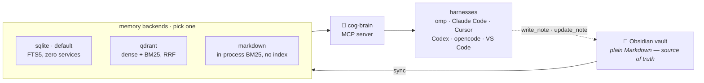

<div align="center">

# 🧠 cog-brain

**Your Markdown vault, recalled automatically and usable from code.**

Local Python API. Automatic project context. Optional MCP. Plain Markdown you own.


</div>

---

cog-brain turns a folder of Markdown notes into a **second brain your agent can
search, read, extend and maintain**. Codex, OMP and Pi can recall project context
automatically and compose operations through a local Python API. MCP remains
available for Claude Code, Cursor, opencode, VS Code and other MCP clients.

The vault is the source of truth — plain, human-editable Markdown. The index is
derived and rebuildable. The **storage engine is swappable** without changing a
single tool. That combination is the point: Markdown-first tools usually have weak
retrieval; vector tools usually aren't human-editable.

> `cog-brain` is the product. `~/SECOND_BRAIN` is just the default vault it points at.

## How it works



Writes re-index automatically. Retracted notes stay searchable and are flagged.
The same tool surface works on every backend.

## Install

### Code Mode and automatic recall: Codex, OMP, Pi

From this checkout:

```bash
uv tool install --editable .
cog-brain install --harness codex --mode code
cog-brain install --harness omp --mode code
cog-brain install --harness pi --mode code
```

Choose the clients you use. Installation adds a shared skill and a read-only
lifecycle hook/extension. Existing files receive timestamped backups; unrelated
hooks are preserved. The client's existing cog-brain MCP entry is disabled to
avoid exposing both interfaces (`--keep-mcp` keeps it enabled). Restart the client;
Codex may require reviewing the new handlers in `/hooks`. No trust bypass is used.
Until hooks are approved, a short managed instruction in Codex AGENTS asks the
agent to obtain project context through the CLI before substantive work. Existing
instructions are preserved.

Bind a project card once. `file_path` is a new root filename; its body links to an
existing vault note. Use the Python environment containing cog-brain, or the JSON
CLI (`cog-brain call project`, arguments on stdin):

```python
from cog_brain import Brain

brain = Brain()
brain.project(
    "my-project.md", "My project", cwd="/absolute/path/to/repo",
    description="Current project state and next action.",
    content="## Goal\nShip the project.\n\n## Next step\nRun the checks.\n\n[[existing-note]]",
)
```

For an existing card, update `repo` to the canonical checkout root and `project`
to its stable identifier. Worktrees resolve through the common Git directory.
No note is automatically created merely because a session starts in a directory.

### Compose operations from code

```python
from cog_brain import Brain

brain = Brain()
result = brain.search("why this decision?", project="my-project", limit=4)
notes = [brain.read(hit["file_path"], max_chars=1200) for hit in result["hits"][:2]]
print({"notes": notes, "index": result["index"]})
```

Only the final output enters model context. This uses the host's normal executor
and permissions; it is not a new sandbox or a provider-specific tool-calling API.
There is no MCP dependency in API/CLI execution and no extra execution server.

```bash
cog-brain context --cwd /path/to/repo --query 'current task' --lexical --budget 6000
```

Lifecycle recall uses local lexical retrieval so it does not wait for Qdrant or
Ollama. It includes the project card, related evidence, warnings and citations.
The budget caps serialized **characters**, not tokenizer-dependent tokens.
Unbound projects are reported; project context is not silently taken from another
repository. Malformed notes are skipped with explicit index warnings.

`Brain.capture()` saves raw input in daily with idempotent event IDs.
`Brain.handoff()` updates a project card's current state, verification, blocker and
next step. Full-body `Brain.update()` requires the revision from `Brain.read()` as
`expected_hash`; append is serialized across cog-brain processes. Atomic writes
preserve YAML fields and comments. External editors do not share cog-brain's
locks: edits observed before publication produce a conflict, but filesystem CAS
against arbitrary editors is not guaranteed.

See [note formats and the daily loop](src/cog_brain/assets/notes.md). Lifecycle
hooks recall evidence; the agent saves verified decisions and handoffs through
the API. They do not automatically summarize or save every conversation.

### 🧩 As a plugin (recommended)

```bash
# oh-my-pi
omp plugin marketplace add cog-sh/cog-brain-plugins
omp plugin install cog-brain@cog-brain-plugins

# Claude Code
claude plugin marketplace add cog-sh/cog-brain-plugins
claude plugin install cog-brain@cog-brain-plugins
```

The plugin registers the server, the skill, and the `/brain-*` commands. Nothing to clone.

### 🔌 Plain MCP client

```json
{
  "mcpServers": {
    "cog-brain": {
      "type": "stdio",
      "command": "uvx",
      "args": ["--from", "git+https://github.com/cog-sh/cog-brain", "cog-brain"],
      "env": { "COG_BRAIN_BACKEND": "sqlite" }
    }
  }
}
```

Or let cog-brain write it for you:

```bash
cog-brain mcp-config --harness cursor        # paste-ready snippet
cog-brain install --harness codex            # merge into ~/.codex/config.toml
```

### 🛠️ From source

```bash
git clone https://github.com/cog-sh/cog-brain && cd cog-brain
uv sync
uv run cog-brain-index        # build the index
uv run cog-brain doctor       # check vault + backend
```

## Memory backends

Pick the engine with `COG_BRAIN_BACKEND` (or `--backend`).

| backend | storage | needs | ranking |
| --- | --- | --- | --- |
| **`sqlite`** *(default)* | one SQLite file | nothing | FTS5 BM25 |
| `qdrant` | Qdrant collection | Qdrant + an embedding endpoint | dense + BM25, RRF |
| `markdown` | none — the filesystem *is* the index | nothing | in-process BM25 |

Adding one is a single module implementing the `Backend` protocol
(`sync` · `search` · `status` · `reset` · `health`). See `src/cog_brain/backends/`.

## Operator CLI

```bash
cog-brain status                 # index health: notes on disk vs indexed, staleness
cog-brain config                 # resolved settings + where each value comes from
cog-brain health                 # 4 metrics with verdicts (orphans, degree, connectivity, stale)
cog-brain lint                   # broken links · orphans · stubs · missing frontmatter
cog-brain doctor                 # diagnose vault, state dir, active backend
cog-brain graph --export graphml # export the wiki-link graph (type as node attr)
cog-brain inspect query "…" -k 10
cog-brain ingest chats export.json
cog-brain backends | reindex | mcp-config | install
```

## MCP tools

- **read** — `semantic_search`, `outline`, `read_note`, `find_related`, `backlinks`,
  `broken_links`, `graph_overview`, `list_notes`, `vault_status`
- **write** — `write_note`, `update_note`
- **index** — `index_now`

## Configuration

Settings resolve **env → `~/.config/cog-brain/config.toml` → default**, so a machine
keeps them in one readable file instead of a shell profile:

```toml
# ~/.config/cog-brain/config.toml
backend = "qdrant"
vault   = "~/SECOND_BRAIN"
```

`cog-brain config` prints the resolved values and where each came from. A missing or
malformed file is ignored, never fatal. Point elsewhere with `COG_BRAIN_CONFIG`.

| variable | meaning | default |
| --- | --- | --- |
| `COG_BRAIN_CONFIG` | config file path | `~/.config/cog-brain/config.toml` |
| `COG_BRAIN_VAULT` | vault root | `~/SECOND_BRAIN` |
| `COG_BRAIN_BACKEND` | `sqlite` · `qdrant` · `markdown` | `sqlite` |
| `COG_BRAIN_STATE_DIR` | index + manifest location | `~/.local/state/cog-brain` |
| `COG_BRAIN_SQLITE_DB` | sqlite path | `<state>/sqlite.db` |
| `COG_BRAIN_QDRANT_URL` | Qdrant endpoint (`qdrant` only) | `http://127.0.0.1:6333` |
| `COG_BRAIN_OLLAMA` | embedding endpoint (`qdrant` only) | `http://127.0.0.1:11434/api/embed` |
| `COG_BRAIN_EMBED_MODEL` | embedding model (`qdrant` only) | `qwen3-embedding:0.6b` |
| `COG_BRAIN_COLLECTION` | Qdrant collection (`qdrant` only) | `cog_brain` |

## Docs

- [`docs/resources.md`](docs/resources.md) — a curated reading list (MCP, agent memory, GraphRAG, evals)
- [`AGENTS.md`](AGENTS.md) — how an agent (or contributor) works *in this repo*

## Related

- 🧩 **Plugins & skills** — <https://github.com/cog-sh/cog-brain-plugins>
