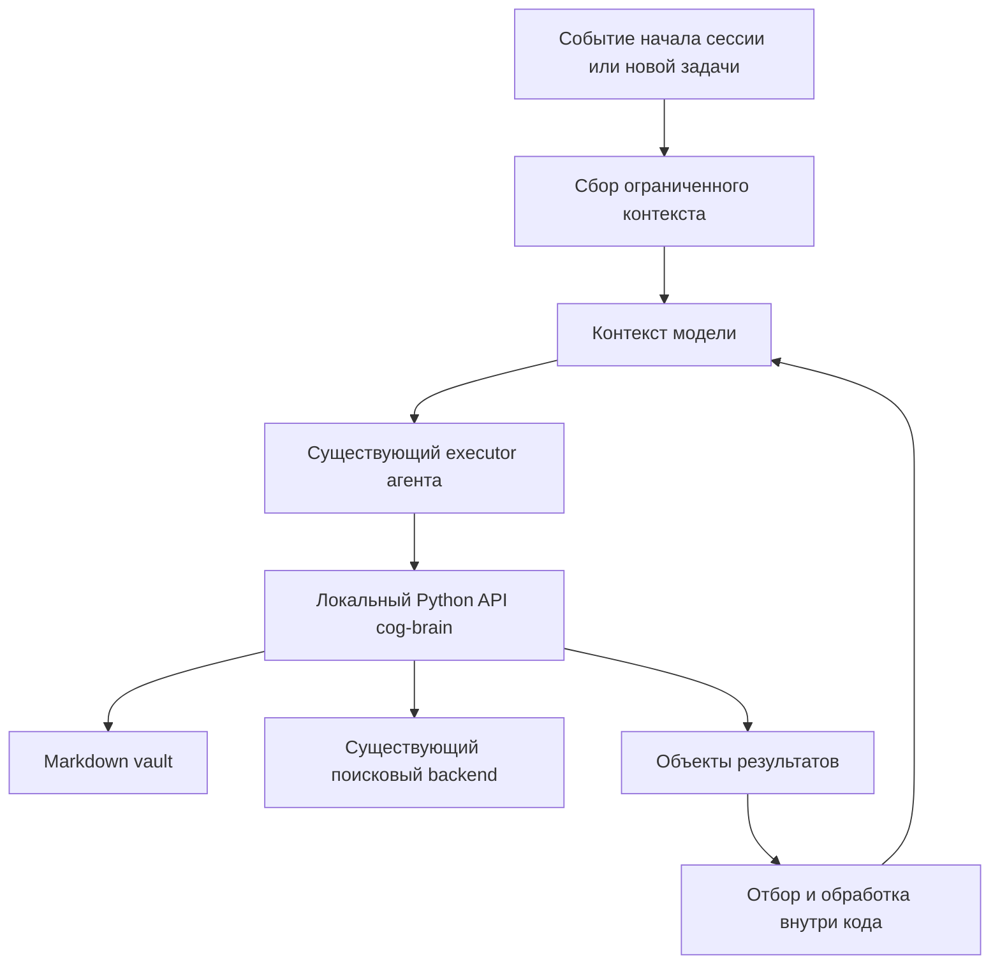

# cog-brain: Code Mode, автоматический recall и формат заметок

Дата: 2026-11-03. Дополнение к [аудиту](daily-workflow-audit-2026-11-03.md), уточняющее основной продуктовый приоритет пользователя: работа из кода без обязательного MCP и память, которая появляется без отдельной просьбы.

Статус: исходный проект решения с последующей реализацией. Python API, context/capture/handoff и интеграции Codex/OMP/Pi реализованы и установлены локально; точные сигнатуры и команды находятся в README.md и общем skill. Низкоуровневые улучшения и проверки перечислены в тестах. Исторические формулировки плана ниже объясняют выбор архитектуры.

## Предлагаемое решение

cog-brain должен предоставлять обычный локальный Python API. Агент вызывает его через уже доступное исполнение кода, выполняет несколько операций, фильтрует данные и выводит только полезный результат. MCP остаётся совместимым адаптером для существующих клиентов, но не является обязательным способом ежедневной работы.

Отдельная интеграция с жизненным циклом агента автоматически добавляет небольшой контекст проекта. Это самостоятельная задача: Code Mode упрощает выполнение операций, но сам по себе не гарантирует, что модель решит обратиться к памяти.

Третья часть решения — устойчивый формат заметок: сырые захваты, проверенные знания и текущее состояние проекта имеют разное назначение. Они остаются в Markdown, понятном человеку.

## Что именно делают Cloudflare, goose и Anthropic

| Источник | Исполнение | Что берём для cog-brain |
| --- | --- | --- |
| Cloudflare Code Mode | Модель пишет код против типизированных методов; runtime исполняет цепочку и возвращает результат | Небольшой API, композиция, обработка промежуточных данных в коде |
| goose by Block | JavaScript в отдельном Boa-контексте; discovery через `list_functions`/`get_function_details`, исполнение через `execute_javascript` | Ограниченное исполнение, загрузка описаний по необходимости, сохранение permission/cancellation semantics |
| Anthropic Programmatic Tool Calling | Модель пишет Python; разрешённые инструменты вызываются из code execution, промежуточные результаты обрабатываются внутри него | Один проход модели для нескольких операций; итог вместо полного потока сырых ответов |

Cloudflare и goose не обещают устранить MCP: он может оставаться транспортом под программным интерфейсом. У goose Code Mode сам предоставлен через MCP. Отказ от MCP в cog-brain — наше отдельное решение об интеграции, а не обязательное свойство этого паттерна.

Anthropic PTC является возможностью API/runtime, а не переключателем, который skill может включить в произвольном Codex/OMP/Pi. Для совместимости с разными моделями следует воспроизвести сам паттерн локальным API и существующим executor. Подключение платного provider API для этого не требуется.

Для одной дешёвой операции обычный вызов может быть проще. Выигрыш Code Mode нужно проверять на составных сценариях: поиск, выбор нескольких заметок, чтение нужных секций, сбор компактного контекста. Проценты экономии из чужих публикаций не являются прогнозом для этого vault.

## Самая простая архитектура без MCP



Сегодня чтение, запись и значительная часть правил находятся в `server.py` вместе с FastMCP. Python API не должен импортировать MCP-сервер как библиотеку: это связывает использование с транспортом и создаёт backend при импорте.

Нужное изменение владения:

1. Перенести операции с заметками, проверки и подготовку результатов из `server.py` в общий модуль прикладных операций.
2. Дать им небольшой публичный Python API с обычными объектами результатов и определёнными ошибками.
3. Вызывать те же операции из CLI, hooks и существующего MCP-адаптера. Не реализовывать отдельную валидацию для каждого транспорта.
4. Инициализировать выбранный backend при создании клиента/по необходимости. Кодовый клиент не должен обходить guards и правила vault.

Это небольшое необходимое разделение ответственности, а не новый сервисный слой с дублирующими интерфейсами. Backend-контракт уже существует и остаётся на своём месте.

Первый runtime — установленный Python через shell/executor клиента. Для Python-репозитория это самый прямой путь: не нужны новый HTTP-сервис, JS-движок и второй SDK. Он работает с правами текущего executor; это не изолированная песочница уровня goose. Ограничения host и доступность каталога vault сохраняются.

Если после измерения понадобится именно единый native `execute` с `brain.*` для OMP/Pi, extension может связать методы с существующим кодовым runtime. JavaScript-адаптер должен передавать структурированные аргументы, а не собирать shell-строки из текста заметок. Для Codex доступность произвольного namespace определяется host; один skill не может добавить его в executor.

Не добавлять endpoint, исполняющий произвольный `eval`/`exec` с доступом к vault. Специализированный sandbox нужен только при явном требовании ограничить исполняемый код; Python в shell не следует выдавать за такой sandbox.

## Как выглядит использование

Пример реализованного API; project должен соответствовать существующей карточке:

```python
import json
from cog_brain import Brain

brain = Brain()
result = brain.search("почему выбрали SQLite", project="cog-brain", limit=5)

selected = []
for hit in result["hits"][:3]:
    note = brain.read(hit["file_path"], section=hit["heading_path"] or None, max_chars=1800)
    selected.append({
        "path": note["file_path"],
        "text": note["text"],
        "retracted": note["retracted"],
        "superseded_by": note["superseded_by"],
        "revision": note["revision"],
    })

print(json.dumps({"index": result["index"], "notes": selected}, ensure_ascii=False))
```

Поиск и дочитывание выполняются одной программой. Модель видит только финальный JSON. Не следует автоматически отбрасывать все снятые заметки: иногда они объясняют решение; признаки снятия и замены должны сохраняться в результате.

Когда алгоритм заранее определён, агенту не нужно каждый раз писать эту программу: операция `context(project, query, budget)` выполняет тот же ограниченный сбор. Code Mode остаётся доступным для нестандартной композиции.

Публичный минимум: search, read, create/update, capture и context. Поведение create/update переиспользуется из существующих операций после исправления целостности. Небольшой справочник сигнатур и 2–3 полноценных примера полезнее большого каталога синонимов. Имена окончательно выбирать при реализации; существующих потребителей не ломать переименованием.

## Память появляется автоматически

### 1. Короткая постоянная инструкция

В контексте всегда присутствует только описание доступной памяти и правил: проектная область, способ дочитывания, сохранение устойчивых выводов. Пользовательские предпочтения загружаются явно и с областью действия; факт из проекта не превращается в глобальное правило.

Не требуется постоянно подмешивать весь vault или переписывать глобальный промпт после каждого сохранения.

### 2. Начало и возобновление сессии

Интеграция определяет проект из канонического корня репозитория и явной привязки к проектной заметке. Worktree и основной checkout должны разрешаться в один проект, если пользователь не разделил их намеренно. Эвристика basename недостаточна: одинаковые имена каталогов не означают одинаковый проект.

Далее загружаются краткое состояние проекта, проверенные ограничения, ближайший шаг и ссылки на знания. Для задачи, ещё неизвестной на старте, тематический поиск не нужен.

### 3. Перед содержательной задачей

Когда известен запрос, hook вызывает context по проекту и тексту задачи. Детерминированно собираются релевантные фрагменты с датой, источником, версией и признаком снятия. Это происходит до решения модели о вызове инструмента.

Поиск запускается для нового содержательного запроса, переключения области или устаревшего контекста; его не надо повторять после каждого tool result. Сначала можно искать на каждый непустой пользовательский запрос с dedup/cache, затем оптимизировать по измеренному шуму, не строя отдельный LLM-классификатор.

### 4. После compact/resume

Восстановить текущую краткую карточку проекта и релевантные ссылки. Версию и hash карточки использовать для обнаружения устаревшего или уже добавленного контекста. Не накапливать одинаковые копии на каждом ходе.

Начальный целевой бюджет: до 6 000 сериализованных символов на пакет в текущей реализации; фактическое число токенов зависит от tokenizer. Первоначальная цель 2 000 токенов относилась к пакету целиком, а не на каждую заметку. Это проектная настройка для первых измерений, не обещание оптимального числа. Нужны также верхний лимит времени, понятная пометка деградации и продолжение с доступными локальными сведениями при сбое retrieval.

### 5. После проверенного решения

Агент сохраняет вывод через прикладной API с причиной и доказательством. В конце содержательной задачи обновляет текущий handoff. Хуки не должны без проверки считать каждое финальное сообщение истинным: автоматически можно сохранить черновой захват или структурированный handoff, а повышение до знания требует явно проверенного содержания.

Не запускать новый вызов LLM после каждого ответа ради пересказа всей сессии. Не полагаться только на shutdown: сессия может завершиться аварийно.

## Подключение к Codex, OMP и Pi

| Клиент | Автоматическая подача контекста | Исполнение без MCP |
| --- | --- | --- |
| Codex | Документированы command hooks `SessionStart`, `UserPromptSubmit`, события compaction; вывод контекста через контракт hook | Существующий shell/executor вызывает Python API или CLI |
| OMP | Extension с `session_start`, `before_agent_start`, событиями обновления контекста/compaction | Существующее исполнение команд; native tool только если потребуется |
| Pi | Extension с `session_start`, `before_agent_start`, context и compaction lifecycle | Существующий bash/executor; собственный code runtime необязателен |

Названия и контракт OMP/Pi событий не считать полностью взаимозаменяемыми. Версии клиентов были обнаружены, но hooks с настоящими model turns не проверялись. У установленного Codex help присутствует механизм доверия hooks; фактическое подключение требует обычного host trust, без его обхода.

Документация Codex подтверждает возможность hooks, поэтому предположение из первоначального обзора «сначала только skill, события не установлены» уточнено: автоматическая подача контекста является реальным направлением. Нужно проверить конкретный lifecycle установленного клиента.

Содержимое заметок должно передаваться как цитируемые данные с маркировкой происхождения. Если host помещает hook output в developer context, доверенная обёртка обязана явно отделять его от инструкций. Текст заметки не получает полномочия запускать команды, изменять политику или экспортировать другие записи.

## Структура заметок для LLM и человека

Сохраняем flat-vault и текущую шкалу `seedling/sapling/evergreen`. Для начала достаточно четырёх назначений:

| Назначение | Где | Что содержит | Как используется |
| --- | --- | --- | --- |
| Быстрый захват | `daily/` | Сырой текст, время, источник | Разбор по запросу; не доказанный факт |
| Знание | Корень, `type: zettel` | Один устойчивый вывод с условиями, причиной, проверкой и ссылками | Поиск и применение в задачах |
| Проект | Корень, `type: project` | Цель, текущее состояние, блокер, следующий шаг, ссылки на решения | Автоматический стартовый контекст и handoff |
| Источник | Корень, `type: source` | Происхождение, дата, исходные утверждения и выдержки | Проверка выводов и сохранение атрибуции |

MOC остаётся человеческим путеводителем. Не требовать новой заметки на каждую реплику или автоматического разбиения каждого источника на фиксированное число сущностей.

### Шаблон знания

Следующий пример иллюстрирует оформление и не утверждает, что решение о fallback уже принято. Новые поля сначала должны стать поддержанными полями API; сегодня нельзя считать их сохранение безопасным.

```markdown
---
title: "Предлагаемый fallback поиска при недоступном Qdrant"
type: zettel
status: seedling
date: 2026-11-03
updated: 2026-11-03
tags: [cog-brain, retrieval]
moc: "[[existing-moc]]"
aliases: ["поиск без Qdrant"]
description: "Проект предложения: использовать локальный lexical search при отказе vector retrieval."
retracted: false
---

## Вывод
Предлагается использовать существующий markdown backend как явно помеченный fallback.

## Когда применимо
Если vector retrieval недоступен, а локальный vault читается.

## Почему
Задаче может быть достаточно lexical retrieval без восстановления Docker.

## Проверка
Не реализовано и не проверено; это предложение.

## Источники и связи
Код markdown backend; [[existing-moc]].
```

Для фактически принятого решения раздел «Проверка» содержит дату, воспроизводимый результат и ссылки на артефакт/commit/source. Предложение никогда не оформляется как внедрённое поведение. Стабильный идентификатор полезен для частых переименований, но вводить его всем историческим заметкам сразу не требуется.

Минимальная схема должна переиспользовать текущие поля. В качестве следующих небольших расширений оправданы `project` для области, `verified_at` для времени проверки и `sources` для происхождения. Добавлять их по конкретному сценарию, сохраняя неизвестные поля. Не назначать LLM числовую уверенность без определённого способа её проверки.

### Шаблон текущего состояния проекта

```markdown
## Цель
Результат, ради которого сейчас ведётся работа.

## Текущее состояние
Что существует и что проверено; с датой.

## Ограничения
Короткие действующие ограничения со ссылками на решения.

## Следующий шаг
Одно конкретное действие, с которого продолжать.

## Блокеры
Неизвестное и необходимый внешний ввод.

## Решения и артефакты
Ссылки на устойчивые заметки, исходники и результаты проверок.
```

Эта карточка обновляется на месте с защитой от конфликтов. История спорных решений сохраняется в связанных заметках. Автоматически добавляемый контекст строится из карточки и источников, а не существует как третья независимо редактируемая копия фактов.

## Ежедневный цикл после внедрения

1. Пользователь открывает проект в любом из трёх агентов. Короткий handoff уже передан в контекст.
2. Пользователь формулирует задачу. Интеграция автоматически добавляет релевантные знания и отметки устаревания.
3. При необходимости агент выполняет программу через Python API, дочитывая точные секции и возвращая только нужные данные.
4. Мысли и ссылки быстро захватываются в daily. Проверенные решения сохраняются как знания с причиной; дубликат обновляется.
5. После задачи обновляется карточка проекта. При следующем входе другой агент видит те же данные.
6. Раз в неделю человек разбирает накопленные захваты и предложения. Массовые слияния/переименования не выполняются автоматически.

Пользователю не нужно каждый раз писать «поищи в cog-brain». Принудительный recall означает гарантированную попытку сбора контекста, но не гарантированную истинность найденного и не гарантированное соблюдение выводов моделью. Последние два свойства требуют проверки источников и eval.

## Порядок реализации

1. Исправить выявленные потери frontmatter, конфликтующие записи и небезопасную замену индекса. Без этого автоматические записи увеличат риск.
2. Выделить Python API из MCP-модуля, обеспечить обычные объектные результаты и короткую документацию вызовов. Существующий MCP переиспользует тот же код.
3. Реализовать context как сбор проектной карточки и найденных фрагментов с лимитом объёма/времени, source paths, revision и retraction metadata.
4. Подключить автоподачу контекста к одному host, проверить реальные startup, новый запрос, resume и compact. Затем добавить оставшиеся два адаптера.
5. Добавить capture/handoff и примеры Code Mode; расширять SDK только под повторяющиеся задачи.

Приёмка: новый запуск без слова «память» получает нужное ограничение; новый агент продолжает по handoff; после compact контекст восстановлен; составной запрос выполняется кодом без промежуточных model turns; отменённое решение не выглядит действующим; параллельная запись не теряется; отключение Qdrant не уничтожает заметки или прежний индекс.

Сравнить baseline MCP, Python Code Mode и автоматический context на одинаковых задачах. Измерить качество ответа, число model turns, выводимые байты/токены, задержку и успешность обновления. Code Mode принимается за удобство композиции и подтверждённый выигрыш, а не просто за наличие `execute`.

## Источники

- [Cloudflare: Code Mode](https://developers.cloudflare.com/agents/tools/codemode/) — текущая документация композиции, discovery и исполнения.
- [Cloudflare: исходное объяснение Code Mode](https://blog.cloudflare.com/code-mode/) — типизированный API вместо каталога прямых вызовов.
- [goose: Code Mode](https://goose-docs.ai/docs/guides/managing-tools/code-mode/) — meta-tools, Boa, ограничения runtime и сохранение permission flow.
- [goose: Code Mode extension](https://goose-docs.ai/docs/mcp/code-mode-mcp/) — способ предоставления самого режима.
- [Anthropic: Introducing advanced tool use](https://www.anthropic.com/research/advanced-tool-use) — Programmatic Tool Calling, обработка промежуточных результатов и ограничения применимости. Примеры версии code execution в этой статье исторические; копировать их как актуальную конфигурацию нельзя.
- [Anthropic: Programmatic Tool Calling](https://platform.claude.com/docs/en/agents-and-tools/tool-use/programmatic-tool-calling) — документационная страница найдена поиском, но прямое получение возвращало timeout/403. Выводы выше опираются на успешно прочитанную первичную статью Anthropic.
- [OpenAI Docs: Hooks](https://learn.chatgpt.com/docs/hooks) — startup, prompt и compaction hooks, передача additionalContext и trust.
- [Pi: extensions](https://github.com/earendil-works/pi/blob/main/packages/coding-agent/docs/extensions.md) и [OMP: hooks](https://github.com/can1357/oh-my-pi/blob/main/docs/hooks.md) — lifecycle и передача контекста. Для новой OMP-интеграции документация рекомендует extensions вместо legacy hooks.
